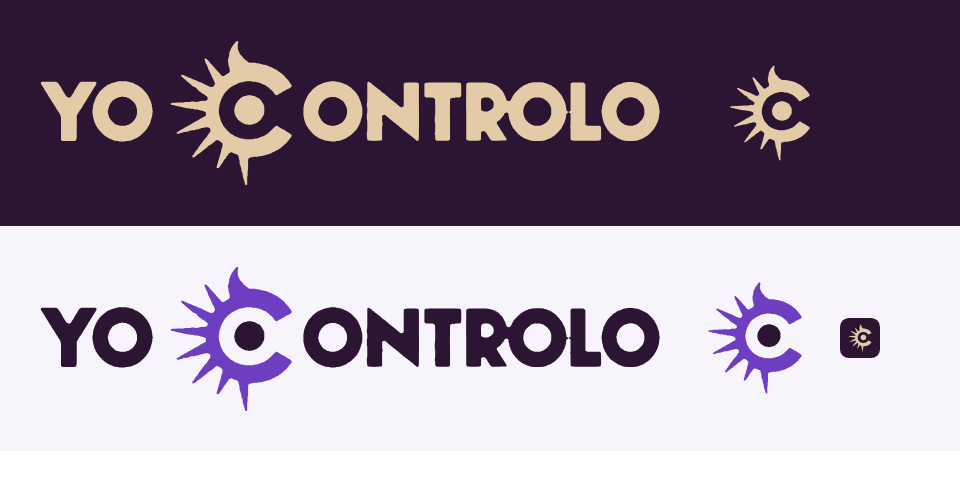

# Marca Yo Controlo

Fuente de la marca del producto (UI-02, 5-nov-2026). Antes se llamaba «Monitor SoftRestaurant»;
el agente de Windows sigue siendo `ArkonAgente` por compatibilidad, y SoftRestaurant se sigue
nombrando donde se habla del POS.



## Archivos

El logo es un wordmark en mayúsculas, «YO CONTROLO», de letra display gruesa, con la C como un
ojo con rayos (estilo grabado o sello). **No se escribe con una fuente**: siempre son estos SVG.
Cada SVG trae sus trazos con `class="letras"`, `"ojo"` y `"pupila"`.

| Archivo | Para qué |
| --- | --- |
| `yocontrolo-oscuro.svg` | Logotipo todo arena, sobre fondos morados u oscuros. Es el de la barra lateral y el login. |
| `yocontrolo-oscuro-fondo.svg` | El mismo, con su fondo morado (para correos, documentos o redes). |
| `yocontrolo-claro.svg` | Letras morado de marca y ojo violeta, sobre fondos claros (README, documentos). |
| `isotipo-oscuro.svg` / `isotipo-claro.svg` | Sólo el ojo-C, sin fondo. El riel de iconos del lateral, la pantalla de carga y la cabecera en el teléfono. |
| `isotipo-app.svg` | Ícono cuadrado: el ojo arena sobre morado (estilo «Clásico»). |
| `isotipo-app-negro.svg` | UI-06: el mismo trazo sobre un cuadrado redondeado **negro** (`#000000`), el logo que mandó Ricardo. Es el favicon, la base de los íconos de la PWA y el ícono del APK. |
| `simplificar.py` | Cómo se aligeraron las copias de `web/public/marca/` (de ~93 kB a ~5 kB): aplana cada trazo y le aplica Douglas-Peucker con tolerancia 0.4 del viewBox, sin cambio visible. Los SVG de esta carpeta son la fuente a precisión completa. `python3 simplificar.py entrada.svg salida.svg`. |
| `trazar.py`, `vector.py` | Cómo se vectorizó el logo desde la imagen original (OpenCV + potrace). El PNG original de 2.6 MB no está en el repo. |
| `preview.png` | Los logos sobre sus fondos, para verlos de un vistazo. |

En el panel viven copias en `web/public/marca/` (las sirve el web; el service worker las guarda
para abrir sin red) y el componente es `web/src/marca/Marca.tsx` (`Logotipo`, `Isotipo`, con
variante `oscuro`, `claro` o `auto` según el tema).

### Íconos del navegador y de la PWA

`web/public/favicon.svg` es `isotipo-app-negro.svg` (UI-06). Los PNG (`web/public/iconos/`: favicon de 32,
192, 512, maskable de 512 y apple-touch de 180) se rasterizan con Chromium desde los SVG:

```
cd web && node scripts/iconos-pwa.mjs   # necesita playwright con Chromium en la máquina
```

El maskable y el apple-touch van a sangre completa (fondo negro y el ojo centrado dentro de la
zona segura del 80 %); los de 192 y 512 son el ícono redondeado tal cual. El `theme_color` del
manifest es `#08070B` y su `background_color` `#000000`; el `<meta name="theme-color">` lo
actualiza `aplicarTema` al color del lateral del estilo elegido.

El APK (`movil/`) hace lo mismo con `movil/scripts/generar-iconos.mjs` (`npm run iconos`): ícono
clásico, redondo y splash sobre negro, y `@color/ic_launcher_background`, la ventana y las barras
del sistema en `#000000` (`yc_negro`). El primer plano del ícono adaptativo es el ojo, sin cambio.

## Colores

Todo color del panel vive en `web/src/tema/paleta.ts` (la regla de lint `tema/sin-colores`
prohíbe escribirlos en otro lado) y `paleta.test.ts` mide el contraste WCAG de cada pareja en los
dos temas. Valores finales:

### Marca

| Nombre | Hex | Uso |
| --- | --- | --- |
| Morado de marca | `#2C1533` | Barra lateral (en los dos temas), cabecera del login, ícono, `theme-color`, texto principal en claro. |
| Arena | `#E3CBA8` | El logo sobre morado; acento secundario (muesca del ítem activo, foco sobre el lateral, avatar). |
| Violeta interactivo | `#6D3FC0` | Primario: botones, ítem activo, enlaces, interruptores; franja de los correos por defecto (factura, cancelación, folios). Acento de fábrica (`ACENTO_POR_DEFECTO`) y la clave `morado` de Plataforma › Ajustes. Hover: `brightness-110` (≈ `#7E52D1`). |

Por qué `#6D3FC0` y no otro: con texto blanco da **6.7:1**, y como texto pasa 4.5:1 sobre todas
las superficies claras sin ajuste. Sobre el morado `#2C1533` el relleno queda en 2.5:1, así que
el ítem activo del lateral lleva además una muesca arena (y el foco del lateral es arena) para
no depender sólo de ese relleno. Por lo mismo, lo elegido en los controles segmentados (periodo,
tema, pestañas) lleva el borde del acento, que da ≥ 3:1 contra su carril en los dos temas
(`paleta.test.ts`). En oscuro, el texto y los bordes del acento se aclaran solos
(`derivarAcento`): enlaces `#AF95DC`, bordes y serie 1 de las gráficas `#926FD0`.

### Tema claro

| Token | Hex |
| --- | --- |
| fondo | `#F7F5FB` |
| superficie | `#FFFFFF` |
| realce / realce-fuerte | `#F1EDF7` / `#E5DEEF` |
| línea suave / línea / línea fuerte | `#F1EDF7` / `#E5DEEF` / `#CDC2DD` |
| tinta / medio / suave / tenue | `#2C1533` / `#3E2A4B` / `#54426A` / `#63527A` (tenue: 5.3:1 sobre realce-fuerte) |

### Tema oscuro (morado, no gris ni azul marino)

| Token | Hex |
| --- | --- |
| fondo | `#1E0E24` |
| superficie | `#2C1533` |
| realce / realce-fuerte | `#3A1F45` / `#4A2B58` |
| línea suave / línea / línea fuerte | `#34193D` / `#4A2B58` / `#6A4A7A` |
| tinta / medio / suave / tenue | `#F6F0F4` / `#EBE0EA` / `#D6C6DA` / `#BEA9C5` (tenue: 5.4:1 sobre realce-fuerte) |

### Barra lateral (igual en los dos temas)

| Token | Hex |
| --- | --- |
| lateral | `#2C1533` |
| lateral-borde | `#40264C` |
| lateral-realce (hover) | `#3C2248` |
| lateral-tinta (texto) | `#F4ECE4` |
| lateral-tenue (encabezados) | `#C3AFC8` |

### Estados y gráficas

Verde (en línea, éxito), ámbar (alerta) y rojo (error) se quedan semánticos, no siguen a la
marca. Únicos ajustes: el ámbar del semáforo y de la serie 3 en claro bajó a `#C96D05` (el
anterior quedaba en 2.9:1 sobre el fondo lavanda), y la serie 2 pasó de índigo a verde azulado
(`#0D8A7F` claro, `#2DD4BF` oscuro) para no confundirse con el violeta de la serie 1.

### Hero y profundidad (UI-05, v3)

El hero del Inicio (la venta del periodo), el MRR de Plataforma y el fondo del login son
**siempre** el morado de marca con un degradado hacia el violeta, como las secciones moradas de
la landing. Sus tokens no siguen al tema de las superficies; `paleta.test.ts` mide su texto
contra los **dos** extremos del degradado (así cualquier punto intermedio pasa).

| Token | Claro | Oscuro | Uso |
| --- | --- | --- | --- |
| hero → hero-fin | `#2C1533` → `#4A2470` | `#3D1C4F` → `#241029` | El degradado (en oscuro sube un escalón para no perderse contra las tarjetas). |
| hero-borde | `#2C1533` | `#5A3570` | Contorno (en oscuro es lo que lo separa del fondo). |
| hero-tinta / hero-tenue | `#F6EEE6` / `#D3C0D9` | igual | Texto y texto secundario sobre el hero. |
| hero-cifra | `#EFD9B6` | igual | La cifra grande y la línea de la gráfica: el arena, un punto más claro. |
| hero-sube / hero-baja | `#8EE6B4` / `#FFB4AC` | igual | El cambio contra la base (siempre con flecha y signo en el texto). |
| hero-rejilla | `#FFFFFF1F` | igual | Rejilla de la gráfica dentro del hero. |
| brillo | `#6D3FC02E` | `#926FD040` | Halo violeta: hover de tarjetas, foco de campos. |
| resalte | `#FFFFFF` | `#FFFFFF14` | El filo de luz de 1 px arriba de cada tarjeta. |

Sombras (`index.css`): `shadow-tarjeta` (filo de luz + contacto + sombra larga y difusa),
`shadow-tarjeta-alta` (al pasar: la difusa se tiñe de violeta) y `shadow-hero`. Radios: tarjetas
`rounded-2xl`, controles `rounded-lg`, insignias `rounded-full`.

Movimiento, siempre con `motion-safe:` (o `prefiereMovimiento()` en JS): las tarjetas del Inicio
aparecen una tras otra al abrir (un solo momento), el punto del «en vivo» late, los esqueletos
destellan y las cifras cuentan del valor anterior al nuevo al refrescarse (en `bigint`, nunca
float; la primera vez se ven tal cual).

## Estilos: «Noche» y «Clásico» (UI-06)

El panel tiene **dos estilos de marca**, que se combinan con el tema claro / oscuro / sistema:

- **Noche** (por defecto): negro con morado y vidrio. El morado `#6D3FC0` sigue siendo el
  principal (botones, ítem activo, enlaces) y el arena `#E3CBA8` va en las cifras del hero y el
  logo. En **oscuro** todo es casi negro (`#0B0910`), con un resplandor violeta fijo detrás del
  contenido. En **claro** sólo se aclaran el fondo del contenido y las tarjetas comunes; el
  lateral, la barra de arriba, la de abajo del celular, el hero del Inicio y el login siguen
  negros.
- **Clásico**: la v3 (UI-05), el morado de marca, sin cambios visuales.

Cómo funciona: `PALETAS[estilo][tema]` en `paleta.ts` (`PALETA` sigue siendo la del Clásico).
`aplicarTema(tema, acento, raiz, estilo)` pone las variables y `data-estilo` en `<html>`; las
reglas del vidrio y del resplandor (`index.css`) sólo aplican con `data-estilo="noche"`, así que
en «Clásico» las clases `vidrio*` y `resplandor` no pintan nada. No hay componentes duplicados.

- **Selector** (`tema/InterruptorEstilo.tsx`): junto al de tema, en la cabecera de escritorio, en
  la hoja «Más» del celular y en el lateral de Plataforma. Se guarda como el tema: en
  localStorage, por usuario (`monitor.estilo.<id>`) y por navegador (`monitor.estilo.ultimo`),
  con try/catch. `iniciarTema` (desde `main.tsx`, antes del primer render) aplica tema y estilo en
  el mismo paso: no hay destello de un estilo al otro.
- **Zona oscura** (`zonaOscura` en `tema.ts`, `zonaOscura` del contexto): en «Noche» claro, los
  marcos negros (cabecera, cabecera del celular y su franja del periodo, login) llevan como
  `style` las variables de la paleta oscura de Noche. Así sus controles comunes (selectores,
  campana, tema) se ven como en oscuro sin tocarlos. React las pone por CSSOM (la CSP lo permite).

### Tokens de «Noche»

| Token | Claro | Oscuro | Uso |
| --- | --- | --- | --- |
| fondo / superficie | `#F3F1F6` / `#FFFFFF` | `#0B0910` / `#16121E` | El contenido y lo opaco (campos, menús). |
| realce / realce-fuerte | `#EEEBF3` / `#E2DEE9` | `#1F1A29` / `#2A2436` | |
| línea suave / línea / fuerte | `#EBE8F0` / `#E0DCE7` / `#C8C2D3` | `#1E1A27` / `#2A2436` / `#433B52` | |
| tinta / medio / suave / tenue | `#15111C` / `#2B2534` / `#463F51` / `#5A5265` | `#F5F2F8` / `#E7E2EE` / `#CDC6D9` / `#ABA2BC` | |
| lateral / borde / realce | `#08070B` / `#1D1926` / `#191522` | igual | Negro en los dos temas. |
| lateral-tinta / lateral-tenue | `#F4ECE4` / `#B5ABC4` | igual | |
| hero → hero-fin | `#1F1535F0` → `#08070BF5` | igual | Casi negro, translúcido (con alfa). |
| hero-borde / hero-rejilla | `#FFFFFF1F` / `#FFFFFF1A` | igual | |
| hero-tenue | `#CDC0D6` | igual | (tinta, cifra, sube y baja: los del Clásico) |
| vidrio | `#FFFFFFB8` | `#16121EBF` | Tarjetas, hero, paneles, filtros; también `vidrio-falso`. |
| vidrio-fuerte | `#FFFFFFEB` | `#16121EEB` | Modales y hojas. |
| vidrio-barra | `#16121EF2` | igual | Cabecera y barra de abajo (siempre negro; la superficie oscura al 95 %). |
| vidrio-borde | `#15111C14` | `#FFFFFF17` | El filo de 1 px (en claro, oscuro: uno claro no se ve). |
| vidrio-brillo | `#FFFFFFCC` | `#FFFFFF12` | El brillo arriba (degradado de 3 rem). |
| resplandor | `#6D3FC024` | `#6D3FC040` | Los dos halos violeta fijos detrás del contenido. |
| muestra-noche / muestra-clasico | `#08070B` / `#2C1533` | igual en todo | Las muestras del selector. |

En «Clásico» los tokens nuevos existen (la lista de tokens es una sola) con valores opacos o
transparentes que nada pinta. Los estados, el semáforo y las series no cambian entre estilos.

### Reglas del vidrio

| Clase | Dónde | Qué hace |
| --- | --- | --- |
| `vidrio` | Tarjetas del Inicio y de Mesas (`SUPERFICIE_TARJETA`), filtros de Tickets, tarjeta del login | `--superficie` → `vidrio`, `--linea` / `--linea-suave` → `vidrio-borde`, `backdrop-filter: blur(18px) saturate(140%)`, brillo arriba. |
| `vidrio-hero` | Hero del Inicio y MRR de Plataforma | Sólo el desenfoque: el fondo es el degradado translúcido `hero` → `hero-fin`. |
| `vidrio-fuerte` | Modales (`Dialogo`, detalle de mesa) y hojas del celular | Como `vidrio` pero casi opaco (`vidrio-fuerte`): detrás puede haber cualquier cosa. |
| `vidrio-barra` | Cabecera, cabecera del celular y barra de abajo | Desenfoque; en la barra de abajo `--lateral` → `vidrio-barra` (la cabecera ya es `bg-superficie/95` en la zona oscura: lo mismo). |
| `vidrio-falso` | Cada mesa, cada turno, la tabla de Tickets, el esqueleto de la rejilla de Mesas, una tarjeta por categoría del Menú (`<Tarjeta repetida>` / `SUPERFICIE_TARJETA_REPETIDA`) | El fondo translúcido y el brillo, **sin** desenfoque. |
| `resplandor` | El armazón del panel, de Plataforma y el login | Un `::before` fijo con dos `radial-gradient` violeta. |

- **Por variables, no por colores.** Las reglas del vidrio van con `:where([data-estilo='noche'])`
  (especificidad 0,1,0) y **nunca** escriben `background-color` ni `border-color`: cambian las
  variables que ya usan las utilidades del elemento (`bg-superficie`, `border-linea-suave`...).
  Así una utilidad semántica puesta encima (`bg-peligro-fondo/40` y `border-peligro-borde` en la
  tarjeta de «Atención requerida» de Mesas) sigue ganando igual que en «Clásico».
  `tema/css.node.test.ts` lo comprueba.
- **Discreto y legible.** `paleta.test.ts` compone cada vidrio sobre lo que puede quedar detrás
  (el fondo con y sin resplandor; para modales, de blanco a negro puros; para las barras, una
  tarjeta blanca; para el login, lateral + hero + resplandor) y mide el texto, el tenue, las
  cifras, el sube/baja y los bordes contra el **peor** resultado. El `saturate(140%)` no se
  modela: cambia el contraste en menos de 0.15.
- **Nunca vidrio sobre vidrio.** Los hijos de un vidrio vuelven a lo opaco (`--superficie-opaca`,
  la del tema o la de la zona oscura), y un `vidrio-falso` dentro de un `vidrio` también (los
  turnos dentro de «Turnos del periodo»).
- **Rendimiento.** Nada de `backdrop-filter` en lo que se repite: en un celular de gama baja,
  decenas de capas desenfocadas hacen tartamudear el scroll. Ahí va `vidrio-falso`.
- **Fallbacks.** Sin `backdrop-filter` (`@supports not`) o con `prefers-reduced-transparency:
  reduce`, el fondo es sólido: la superficie opaca en tarjetas y modales, el negro en la barra de
  abajo, y sin desenfoque. El hero ya es casi opaco (94–96 %).
- **Modales en portal.** Un `backdrop-filter` vuelve al elemento el contenedor de sus hijos
  `fixed` y un contexto de apilamiento. Por eso `Dialogo`, el detalle de mesa y `HojaInferior`
  se montan con `createPortal` en `<body>`: los diálogos de Facturación se abren desde dentro de
  la tarjeta «Facturas emitidas» y sin portal sólo cubrían la tarjeta.

## Tipografía

- **Lilita One** (la display de la landing) sólo para el `h1` de cada vista (UI-05). Trae un
  solo peso: `font-synthesis: none` evita las negritas falsas.
- **Outfit** 600/700 para subtítulos (`h2`, `h3`, `font-titulo`) y el número de mesa.
- **Inter** 400–700 para todo lo demás. Las cifras de dinero grandes (KPI, hero) van en Inter
  semibold con cifras tabulares y `tracking-tight`: no bailan cuando cuentan.

Las tres empaquetadas con `@fontsource` (sólo el subconjunto latin y esos pesos; ver
`web/src/main.tsx`): la CSP del sitio es `font-src 'self'`.
